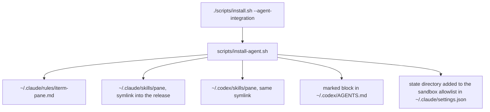

# Agent integration

Optional, opt-in wiring that makes coding agents use `pane` automatically: session instructions, the pane skill, and one sandbox allowlist entry. The runtime works without any of it; an agent only reaches for `pane` when something it reads every session says so.



## Run it

```text
# Runtime plus agent wiring
./scripts/install.sh --agent-integration

# Or wire agents after a plain install (and re-run anytime)
./scripts/install-agent.sh

# Undo just the wiring, or everything
./scripts/install-agent.sh --remove
./scripts/uninstall.sh
```

`--no-settings` skips the `settings.json` allowlist edit when that file is managed elsewhere.

## What it touches

| artifact | path | written how | removed by |
| --- | --- | --- | --- |
| session instructions | `~/.claude/rules/iterm-pane.md` | one file, loaded by every session | deleting the file |
| pane skill | `~/.claude/skills/pane`, `~/.codex/skills/pane` | symlink into `current/agent/skills/pane` | removed only when the link points into the pane install |
| session instructions | `~/.codex/AGENTS.md` | body of `agent/instructions.md` between the `iterm-pane-manager:begin` and `:end` markers | removing between the markers restores the original bytes |
| sandbox allowlist | `~/.claude/settings.json` | `$HOME/.local/state/iterm-pane` added to `sandbox.filesystem.allowWrite`, rewritten only when the entry is actually missing | removed only when this installer added the entry; a file untouched since installation is restored byte-for-byte |

Only an agent home that already exists is touched. A path already holding foreign content (a rules file whose first line is not the installer's provenance comment, a mismatched marker pair, a symlink pointing outside the install, or a directory that is not ours) is left in place with a warning. `settings.json` that does not parse is left untouched with the snippet printed. Removal restores user-owned files byte-for-byte: an allowlist entry that predates the installer is never deleted, and settings edited after installation keep those edits.

## Manual steps

When the script cannot run, do the same four things by hand:

1. Create `~/.claude/rules/` if needed and copy `agent/instructions.md` to `~/.claude/rules/iterm-pane.md`, prepending a comment that names the iterm-pane-manager repository as the source.
2. `ln -s ~/.local/share/iterm-pane-manager/current/agent/skills/pane ~/.claude/skills/pane` (same for `~/.codex/skills/pane`).
3. Append the body of `agent/instructions.md` to `~/.codex/AGENTS.md`, wrapped in the two `iterm-pane-manager` markers.
4. Add `"$HOME/.local/state/iterm-pane"` to `sandbox.filesystem.allowWrite` in `~/.claude/settings.json`, keeping the file valid JSON.

## Environment overrides

Used mainly by `tests/shell/agent-install-test.sh`:

- `ITERM_PANE_INSTALL_ROOT`: the installed runtime (default `~/.local/share/iterm-pane-manager`)
- `ITERM_PANE_AGENT_CLAUDE_HOME`: default `~/.claude`
- `ITERM_PANE_AGENT_CODEX_HOME`: default `~/.codex`

## Troubleshooting

- **Session instructions do not load.** Very old Claude Code versions without the user rules directory ignore the file; the skill still loads. Update Claude Code, or append the same text to `~/.claude/CLAUDE.md` by hand.
- **`pane` works by hand but not from a sandboxed agent.** The sandbox blocks writes to pane's state directory or to the document's folder. The installer adds the state directory to the allowlist; a permission error naming some other path needs that call run outside the sandbox.
- **A warning says a file was left unchanged.** The path holds foreign content, or `settings.json` does not parse. Move the foreign file aside, or fix the JSON, then re-run.
- **A background job cannot show a pane.** Correct and by design: the process inherited `ITERM_SESSION_ID` rather than earning it, and pane's error says so. The agent should print the path and move on; the refusal rules are in `docs/goals.md`.
