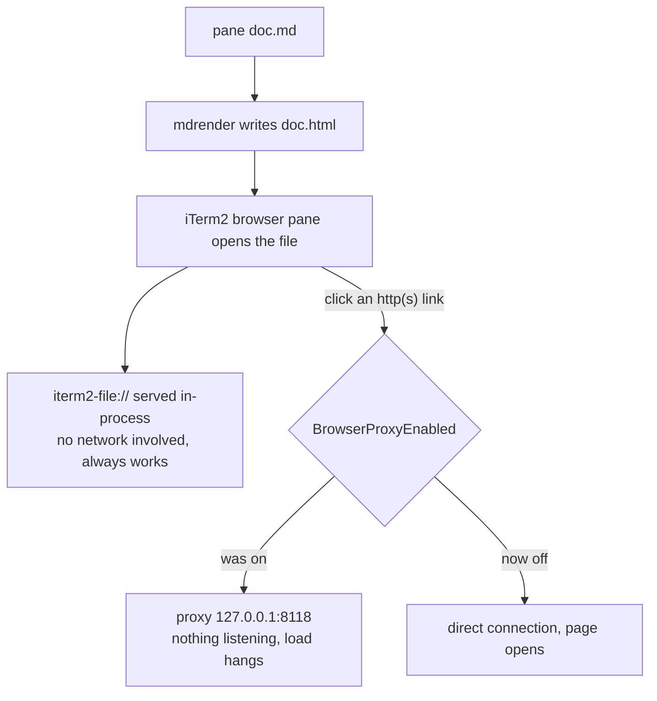

# Why links in side-pane documents did not open

**Answer:** iTerm2's optional browser proxy was switched on and pointed at a dead
address (`127.0.0.1:8118`). Every web request from every browser pane was routed
to that dead proxy and hung. Rendered documents kept working because they are
served locally and never touch the network. Found and turned off 2026-10-08.
The pane tool itself was never at fault.

## The mechanism



- iTerm2 3.7 attaches the proxy to every browser web view's data store at
  creation (`iTermBrowserManager.configure` calls `applyProxyConfiguration`;
  verified in iTerm2 v3.7.3 source).
- With no `BrowserProxyHost` or `BrowserProxyPort` preference set, the proxy
  defaults to `127.0.0.1:8118`, which is Privoxy's standard port
  (`iTermAdvancedSettingsModel.m`). Privoxy is not installed on this machine
  and nothing listens on port 8118, so every load was pointed at nothing.
- Local documents are unaffected because `iterm2-file://` pages are served by
  iTerm2 itself. Only real web traffic goes through the proxy. That is exactly
  why the pane looked "good only for local HTML files".

## The experiment that proved it

One browser pane was opened with `pane https://example.com`, then navigated
through iTerm2's own Python API (`session.async_load_url`). Only the proxy
setting changed between the two columns:

| measurement | proxy on | proxy off |
|---|---|---|
| `load_url("https://example.com/")` | never completed within 20 s | completed in 2.4 s |
| page title reaching the session (`name` variable) | `' '`, never set | `'Example Domain'` |

For browser sessions the `name` variable follows the page title
(`browserViewController(_:didUpdateTitle:)` calls `setUntrustedIconName`), so
`'Example Domain'` confirms the page loaded, not just that the call returned.

## The fix

```sh
defaults write com.googlecode.iterm2 BrowserProxyEnabled -bool NO
```

- Applies to browser panes opened after the change. A pane created before it
  may need to be closed and reopened, because a browser session takes its proxy
  configuration when it is created.
- Reversible with `-bool YES`, but that is only useful if a proxy actually runs
  at `BrowserProxyHost:BrowserProxyPort`. The browser's own Settings page
  (`⌘,` in a browser pane) exposes the same toggle.
- If a filtering proxy is wanted on purpose (Privoxy and similar), keep the
  setting on and point host and port at the real address instead.

## Notes

- When or how the setting was switched on is unknown. Nothing has ever
  listened on 8118, so it never worked in any form seen on this machine.
- A 2026-09-28 note recorded `load_url("https://example.com/")` as
  "successful". That measurement judged the call's acceptance, not a completed
  page load, or the setting was enabled after it. Both remain possible. The
  controlled experiment above is the operative evidence.
- To verify by hand: click any https link inside any rendered document and it
  opens in the pane. `defaults read com.googlecode.iterm2 BrowserProxyEnabled`
  must print `0`.
