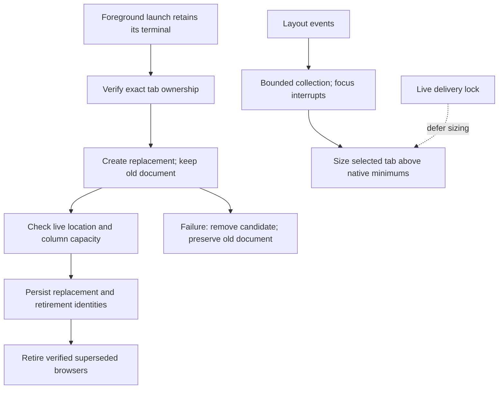
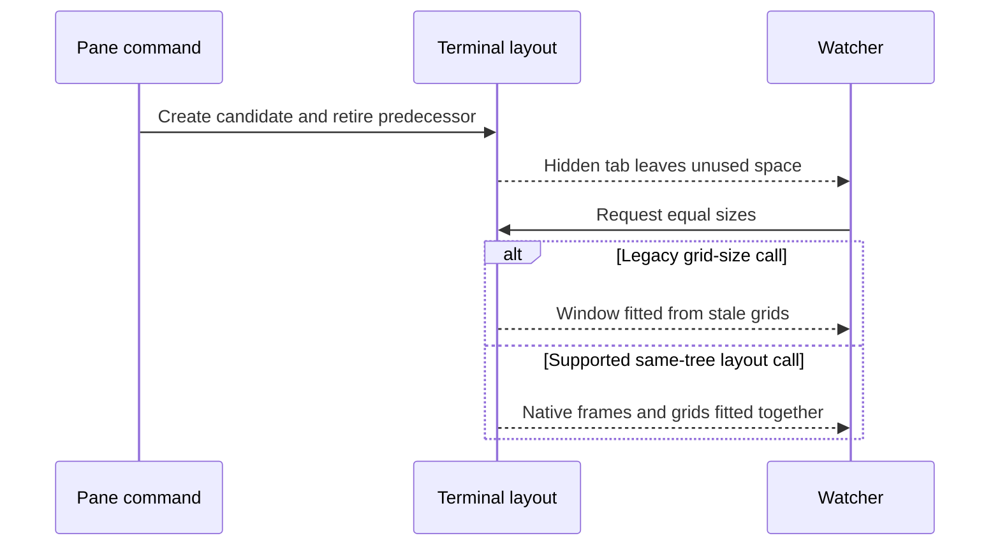
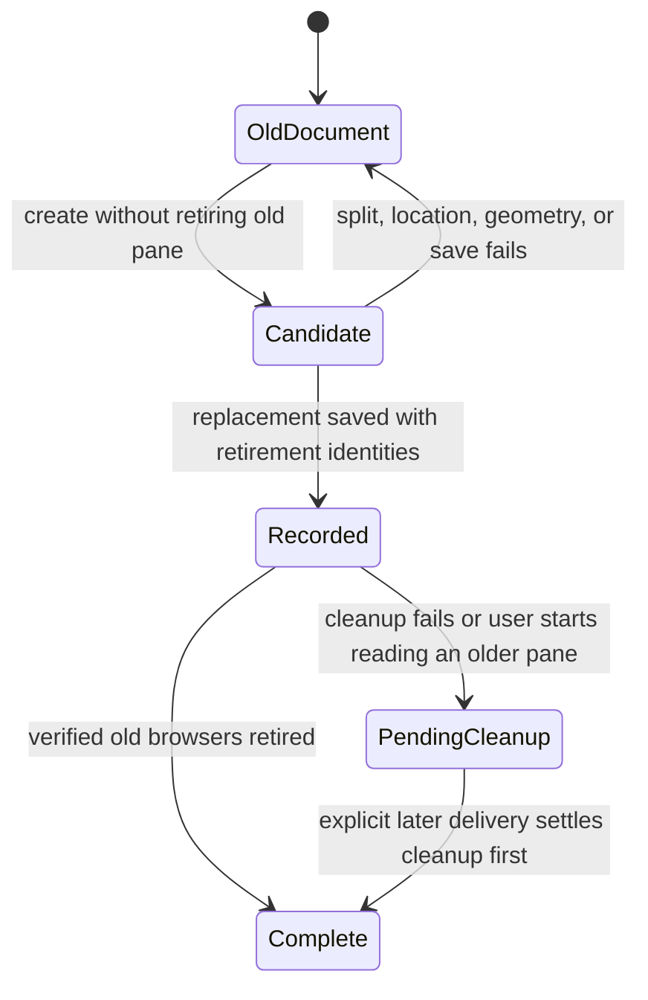

# Reliable document panes



Canonical task and continuation record. The owner asked to repair uneven widths, misleading space errors, and foreground sessions refused as detached. On October 29 the owner authorized implementation after self-review and the full development cycle. The plan self-review passed. Implementation is pushed in pull request [39](https://github.com/anik8das/iterm-pane-manager/pull/39). Required hosted checks and shared review are in progress.

## Confirmed causes and repairs

| Cause, at the original revision | Evidence | Repair now implemented |
| --- | --- | --- |
| Command service loses the displayed session's terminal identity. | Command ancestry reaches a detached service; its inherited address was absent from all 15 live sessions. `caller.mjs`, `anchor.mjs`, and the ownership guard correctly refuse that executor. The September 28 repair on the review host was absent here. | Optional removable shell integration uses the supported foreground execution flag for visible interactive launches. Service, explicit remote, help, and noninteractive calls retain their arguments. Existing sessions are not restarted. |
| A restored foreground terminal keeps an expired session address. | The owner's later screenshot shows a live foreground terminal reporting a closed tab. All four live foreground processes retain addresses from before the crash. Native session identifiers changed; the kernel terminal devices did not. Native `tty` variables are absent after restoration, while native process identifiers still map to the correct devices. | `ownership.mjs` resolves only a unique native session matching the caller's actual device. `sessions.py` can derive a restored session's device from its native process. An explicit expired address, an ambiguous match, a detached caller, or a conflicting device remains refused. |
| Event collection can postpone sizing forever. | Original `watch.py:214–222` restarts a quiet-period timer after each event. A 50 ms event stream produced zero sweeps, including after a focus change, until the stream stopped. | Collect for one bounded interval; an arriving focus event ends it immediately. |
| A deferred resize can overwrite a user's pane selection. | A simulated selection during refresh triggered activation even though no layout had been applied. | Restore selection only following an applied layout. Recheck active tab and command lock after any profile reads. |
| Intentional stacked rows are called uneven. | Equal-width columns with two stacked neighbors were reported as uneven by 351 points. | Compare measured panes with targets for their actual split-tree positions. Retain the existing physical-unit calculation and 12-point spread allowance. |
| Native browser minimum conflicts with a fixed document count. | iTerm 3.7.6 `PTYTab.m:3279–3280` requires browser frames of at least 395 by 150 points. Four equal columns across 1,440 points are narrower than 395. Its split precondition rejects an existing browser below its minimum. Historical failures lack geometry, so this condition is source-proved, not a reconstruction of every old rejection. | Derive document capacity from live width and column units, bounded by the existing maximum of three. Never submit equal widths below the native browser minimum. Defer the watcher during a command's creation and retirement sequence. |
| Every split rejection is called a space shortage. | Original `pane.mjs:351–353` relabels every `CANNOT_SPLIT`. The native response also covers layout locking, floating panes, and unsuccessful creation. | Preserve the actual rejection and report possible native constraints without claiming a proven shortage. |
| Failed replacement destroys the old document. | Original `document.py:166` closes it before a fallible split. A failing split left the old pane closed and absent. Capacity eviction also preceded creation. | Create and verify first, persist the replacement second, retire old browsers last. Persist unfinished retirement identities so interruption does not lose ownership. Validate profile, browser type, live tab, and selected document before retirement. |
| Full gate rejects a worktree's metadata pointer. | Baseline tests passed, but its source scan matched the personal path inside the `.git` file. | Scope out Git metadata, keep all source and untracked-file checks, and fail on scanner errors. Regression fixtures cover both preserved guard cases. |

The installed source matched `origin/main` at `d0d96d9`; repeating the earlier grid-to-point repair would have fixed nothing. Baseline live widths of 478/480/480 and 715/724 points were already within rounding tolerance.

## Native sizing diagnosis



- A live fixture reproduced the missing-space condition: after retirement, remaining pane widths were 252/395/395 across an available 1,440-point area. `point_targets` treated the pane-sized hole as divider space and allocated only the occupied 1,044 points. Equal 347-point requests were therefore impossible despite the unused space.
- `even_tab` now receives the existing window-content measurement and skips already equal physical layouts, including harmless grid rounding. The older native sizing path has separately confirmed upstream defects: shadowed divider state and missing session-grid fitting before window fitting.
- The supported `async_apply_layout` call, using exactly the same session identifiers and split tree, passed six opens/replacements at 479/479/480 points with focus unchanged. It also passed a forced state-save failure with the old document retained and no orphan. The integrated source subsequently passed the same sequence after correcting the divider calculation. Only native one-point dividers are reserved; the rest of the gap is usable content. The failure test retained the old document with no orphan.
- Native tree sizing is used only when its equal child shares match the existing leaf-unit policy. The established grid path remains for older protocols and more complex weighted trees. Native errors propagate; there is no mutation retry or timeout increase.

## Design decision and self-review

| Option | Decision and trade-off |
| --- | --- |
| Targeted repair within the existing architecture | Chosen. Keep the command boundary, small terminal helpers, file renderer, state store, and one watcher. Foreground sessions have their own helper processes. A physically full tab can still refuse delivery while retaining existing documents. |
| A new local preview web service | Not chosen. It could enable browser navigation in place, but introduces a service and address/permission lifecycle before a need is established. |
| Guess the selected tab | Rejected. Violates ownership and can deliver into someone else's work. |

- A disposable background tab proved that a candidate can be created with the old browser retained: 482 ms and 362 ms, with global focus unchanged. The fixture was closed afterward. Native local-file navigation still returns `FAILED: Invalid URL`.
- The original plan was corrected: verifying the browser is insufficient if a later state write can fail. `delivery.mjs` now coordinates persistence and checked retirement. Additive `retiring` and `previous` state fields preserve unfinished work; there is no server or new state engine.
- Replacements split beside their predecessor before retirement, preserving document order. Already equal physical layouts and unchanged grid requests are skipped: the installed native release unnecessarily rebuilds them and can shrink panes. Upstream separately fixed this in `f1cd67a6b4` and actual sizing loss in `2f8c65b462`; the latter native defect remains a verification concern.
- Column budgeting uses fresh session locations, not remembered tab membership. A selected document, a terminal, a moved browser, or a changed profile is never an automatic victim.
- The source guard remains intact. A documented long CLI option whose characters resemble a key prefix is assembled from readable parts; no credential pattern is excluded or weakened.
- Contracts read: `AGENTS.md`, `docs/goals.md`, `CONTRIBUTING.md`, and the complete check script. No separate numeric line/file budget contract exists here.

## Failure boundary



Before persistence, failure retains old documents and removes only the new candidate. After persistence, a cleanup failure is reported as an opened, tracked document with pending cleanup; it is not falsely reported as an unopened document. State and terminal errors stay visible. No retries or timeout increases were introduced.

## Validation and remaining work

- Latest completed full gate: 96 Node tests, 67 Python tests, lint, formatting, audit, 72 installation assertions, and source guard all passed. Rerun after further edits before publication.
- A real disposable terminal ran the complete command with a deliberately expired inherited address and no explicit anchor. Opening and closing both passed, with delivery to the correct background tab and focus unchanged. That fixture was closed afterward.
- New tests cover steady event streams, focus interruption, deferred selection, stacked layouts, native minimums, split failure, state-write failure, pending cleanup, moved documents, shell installation/removal, foreign configuration, and argument preservation through a real terminal device.
- The original watcher logged repeated 15-second timeouts without a stage. A later process sample proved that a native file-opening confirmation was running a modal loop, blocking terminal requests. The owner reported no remaining dialog; the interface then recovered and the background verification passed. Stage-specific diagnostics retain that distinction; timeout limits are unchanged.
- The crash report later confirmed that the background-window probe triggered native `assert(profile)` in `iTermSessionFactory.m:379`, through profile-less new-window creation. The interruption was acknowledged to the owner. Do not use that probe again. The application and its interface recovered. Terminal servers and recovery data were preserved.
- An earlier background-tab run timed out during sizing and cleanup. It was preserved as a failed result; the fixture was closed by its exact recorded terminal identity. The final integrated run passed all six deliveries, replacements, capacity retirement, and forced save-failure checks. Its owned fixture was closed. Focus comparisons use each operation's baseline, allowing normal user navigation between operations.
- Live checks passed for selected-tab open/replacement, hidden-tab focus preservation, width-constrained retirement, mixed font sizes, stacked rows, and zoom exclusion. The mixed/stacked target deviation was 0.5 points; the window size was unchanged. The selected fixture was left alone when the owner navigated away. All owned fixtures with receipts were closed. The health check passed after the earlier application restart.
- Local review also repaired close-after-interrupted-retirement bookkeeping, an anchor-move race during retirement, and a dangling shell-startup symlink being mistaken for an absent file. The installer now refuses that link before writing any integration record. Local diff review passed. Finish the owning-account pull request, hosted checks, one review through the shared review host, all finding dispositions, normal staged installation on this Mac, and installed-path verification. Do not install a candidate whose final health check cannot run.

## Live state and continuation

- Worktree: `~/.local/share/agent-workspaces/iterm-pane-manager/pane-reliability`; branch `fix/pane-reliability`; base `d0d96d9`. Pull request 39 is open. Its current source revision is shown by the live commands below; a small installer-link correction follows the initial implementation.
- Shared review host assigned owner `anik8das`. Overlap checks found no competing pane implementation; open requests were dependency updates. Do not change the review host's runtime installation or start another review ledger.
- Main changes: `src/node/delivery.mjs` coordinates replacement and retirement; `sessions.py` supplies live geometry and verifies retirement; `layout.py` and `watch.py` handle safe sizing; `agent/foreground.mjs` and `agent/install-foreground.mjs` install reversible launch routing. `bin/pane.mjs` delegates delivery under its existing state lock.
- The diagnostic foreground watcher ended when the terminal connection closed and its `finally` restored the existing watcher service. Its observation log is in the check environment; verify live processes rather than assuming it remains active.
- Both installed coding tools are in scope. They share ownership, delivery, and sizing helpers; the removable foreground-launch integration addresses the tool that otherwise uses a detached execution service. The owner's 7:35 screenshot independently confirms the current shared connection outage.
- Final installation is gated on a healthy native interface. After the successful live fixtures, a candidate health check timed out before connecting. A new native sample showed the main thread inside tab-bar cell layout, rather than the earlier file-opening confirmation. The owner reported no visible dialog. Do not represent this timeout as passed or raise its deadline. Continue review independently; preserve terminal servers and recovery data.
- The existing watcher is now paused deliberately to prevent it competing with verification. It was not paused before this task. Resume it with the verified runtime before finishing; do not leave this temporary pause as the fix.
- The previous pane preview attempt was refused because this executor's inherited tab address had expired. Do not retry with an invented anchor. Render updates without opening until a new foreground session has a valid identity.
- Keep the worktree during open review. Remove only its dependencies and temporary fixtures after their use ends; never remove another workspace or an open-review checkout.

```sh
PANE_CHECK_ENV="$(getconf DARWIN_USER_TEMP_DIR)/pane-reliability-check.p97E12ZRP5"
git status --short
git log -1 --oneline
PYTHON="$PANE_CHECK_ENV/venv/bin/python3" ./scripts/check.sh
pane --doctor
pane --watch-status
tail -40 "$PANE_CHECK_ENV/watcher-observation.log"
```

Native references: [layout application contract](https://iterm2.com/python-api/app.html#iterm2.App.async_apply_layout), [native thin dividers](https://github.com/gnachman/iTerm2/blob/v3.7.6/sources/TerminalView/PTYTab.m#L117), [browser minimum and split constraints](https://github.com/gnachman/iTerm2/blob/v3.7.6/sources/TerminalView/PTYTab.m#L3276), [request handler](https://github.com/gnachman/iTerm2/blob/v3.7.6/sources/API/iTermAPIHelper.m#L2689), and [split preconditions](https://github.com/gnachman/iTerm2/blob/v3.7.6/sources/TerminalView/PseudoTerminal.m#L11645).
