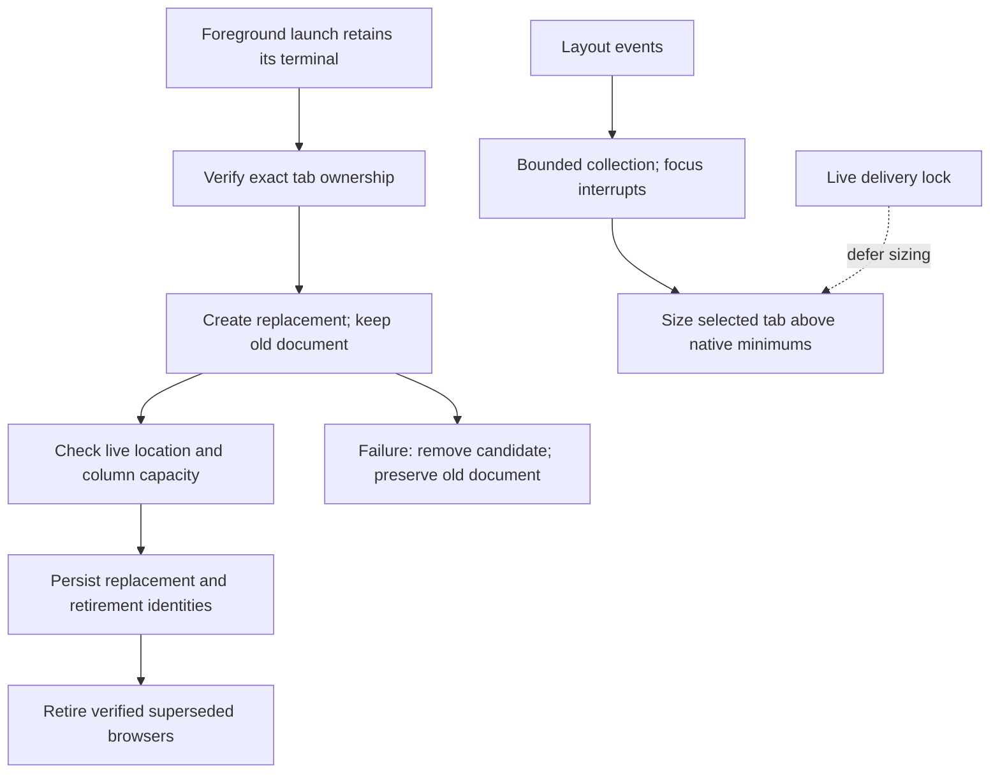
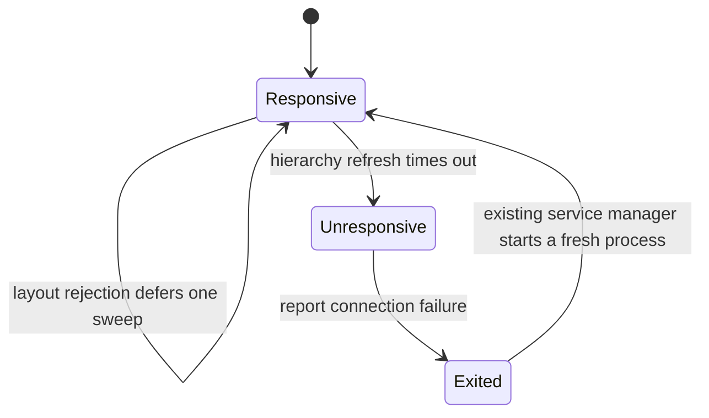
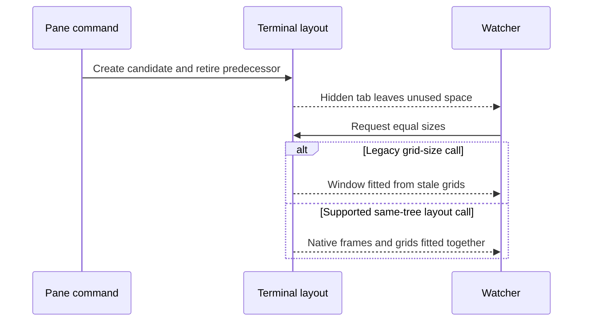
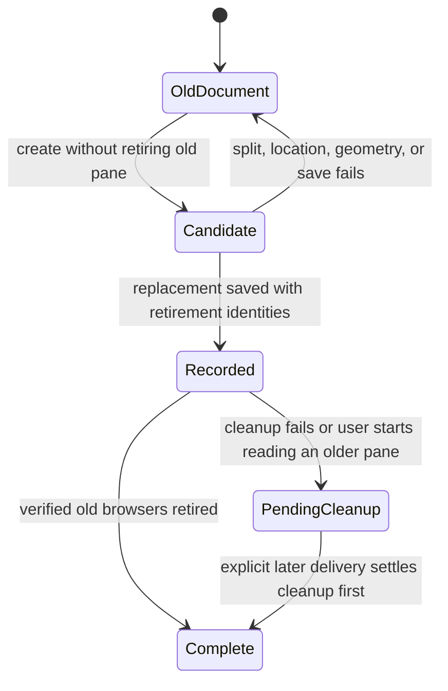

# Reliable document panes

The repairs address uneven widths, misleading space errors, and foreground sessions refused as detached. The implementation follows the existing command, helper, state-store, and watcher boundaries.

## Confirmed causes and repairs

| Cause, at the original revision | Evidence | Repair now implemented |
| --- | --- | --- |
| Command service loses the displayed session's terminal identity. | Command ancestry reaches a detached service; its inherited address was absent from all 15 live sessions. `caller.mjs`, `anchor.mjs`, and the ownership guard correctly refuse that executor. The September 28 repair on the review host was absent here. | Optional removable shell integration uses the supported foreground execution flag for visible interactive launches. Service, explicit remote, help, and noninteractive calls retain their arguments. Existing sessions are not restarted. |
| A restored foreground terminal keeps an expired session address. | The owner's later screenshot shows a live foreground terminal reporting a closed tab. All four live foreground processes retain addresses from before the crash. Native session identifiers changed; the kernel terminal devices did not. Native `tty` variables are absent after restoration, while native process identifiers still map to the correct devices. | `ownership.mjs` resolves only a unique native session matching the caller's actual device. `sessions.py` can derive a restored session's device from its native process. An explicit expired address, an ambiguous match, a detached caller, or a conflicting device remains refused. |
| Event collection can postpone sizing forever. | Original `watch.py:214–222` restarts a quiet-period timer after each event. A 50 ms event stream produced zero sweeps, including after a focus change, until the stream stopped. | Collect for one bounded interval; an arriving focus event ends it immediately. |
| A deferred resize can overwrite a user's pane selection. | A simulated selection during refresh triggered activation even though no layout had been applied. | Restore selection only following an applied layout. Recheck active tab and command lock after any profile reads. |
| Intentional stacked rows are called uneven. | Equal-width columns with two stacked neighbors were reported as uneven by 351 points. | Compare measured panes with targets for their actual split-tree positions. Retain the existing physical-unit calculation and 12-point spread allowance. |
| Native browser minimum conflicts with a fixed document count. | iTerm 3.7.6 `PTYTab.m:3279–3280` requires browser frames of at least 395 by 150 points. Four equal columns across 1,440 points are narrower than 395. Its split precondition rejects an existing browser below its minimum. Historical failures lack geometry, so this condition is source-proved, not a reconstruction of every old rejection. | Derive document capacity from live width and column units, bounded by the existing maximum of three. Never submit equal widths below the native browser minimum. Defer the watcher during a command's creation and retirement sequence. |
| Every split rejection is called a space shortage. | Original `pane.mjs:351–353` relabels every `CANNOT_SPLIT`. The native response also covers layout locking, floating panes, and unsuccessful creation. | Preserve the actual rejection and report possible native constraints without claiming a proven shortage. |
| Failed replacement destroys the old document. | Original `document.py:166` closes it before a fallible split. A failing split left the old pane closed and absent. Capacity eviction also preceded creation. | Create and verify first, persist the replacement second, retire old browsers last. Persist unfinished retirement identities so interruption does not lose ownership. Validate profile, browser type, live tab, and selected document before retirement. |
| Full gate rejects a worktree's metadata pointer. | Baseline tests passed, but its source scan matched the personal path inside the `.git` file. | Scope out Git metadata, keep all source and untracked-file checks, and fail on scanner errors. Regression fixtures cover both preserved guard cases. |
| Launcher removal leaves obsolete restoration records. | The `!managed` return in `install-foreground.mjs` skipped record cleanup after a startup file was deleted or replaced. A later install reused the old backup, allowing removal to overwrite the new user file. | Clear this installation's records when its block is absent. Preserve the user file or dangling link. Regression coverage includes originally present and absent files, deletion, manual replacement, and a complete reinstall/removal cycle. |
| Strict width settings disappear at submission. | `Watcher.reason_for` used the configured tolerance, but `even_tab` rechecked with the default 12 points. A 10-point spread requested with a 2-point allowance was skipped and remembered as settled. | Forward the same tolerance through measurement and submission. One-shot callers retain the default. Regressions verify strict native sizing and watcher forwarding. |
| A failed update stops the existing sizing service. | `install.sh` rollback called `bootout` before checking whether promotion had begun, but restarted the previous service only when `switched` was true. A staged-test failure therefore stopped a service the update had never replaced. | Service rollback runs only after promotion starts. Mark that boundary before stopping the old service, covering a failed link switch too. An isolated failed-staging regression verifies no service call and unchanged previous runtime. |

The installed source matched `origin/main` at `d0d96d9`; repeating the earlier grid-to-point repair would have fixed nothing. Baseline live widths of 478/480/480 and 715/724 points were already within rounding tolerance.

## Connection lifecycle

- The watcher could keep a connection that stopped answering hierarchy reads. Fresh one-shot commands still returned eight sessions while the same watcher logged repeated 15-second read timeouts. Restarting only that watcher restored sizing, with no terminal-application restart: its next focus event corrected widths to 479/480 points.
- `sweep_guarded` previously treated every timeout as a temporary layout failure and kept that connection indefinitely. A hierarchy-read timeout now ends its one connection lifecycle. The existing service manager owns restart and its existing delay; transient layout rejection still defers only that sweep. Timeout limits and connection count are unchanged.

## Native sizing diagnosis

- A live fixture reproduced the missing-space condition: after retirement, remaining pane widths were 252/395/395 across an available 1,440-point area. `point_targets` treated the pane-sized hole as divider space and allocated only the occupied 1,044 points. Equal 347-point requests were therefore impossible despite the unused space.
- `even_tab` now receives the existing window-content measurement and skips already equal physical layouts, including harmless grid rounding. The older native sizing path has separately confirmed upstream defects: shadowed divider state and missing session-grid fitting before window fitting.
- The supported `async_apply_layout` call, using exactly the same session identifiers and split tree, passed six opens/replacements at 479/479/480 points with focus unchanged. It also passed a forced state-save failure with the old document retained and no orphan. The integrated source subsequently passed the same sequence after correcting the divider calculation. Only native one-point dividers are reserved; the rest of the gap is usable content. The failure test retained the old document with no orphan.
- Native tree sizing is used only when its equal child shares match the existing leaf-unit policy. The established grid path remains for older protocols and more complex weighted trees. Native errors propagate; there is no mutation retry or timeout increase.

## Design decision and self-review

| Option | Decision and trade-off |
| --- | --- |
| Targeted repair within the existing architecture | Chosen. Keep the command boundary, small terminal helpers, file renderer, state store, and one watcher. Foreground sessions have their own helper processes. A physically full tab can still refuse delivery while retaining existing documents. |
| A new local preview web service | Not chosen. It could enable browser navigation in place, but introduces a service and address/permission lifecycle before a need is established. |
| Guess the selected tab | Rejected. Violates ownership and can deliver into someone else's work. |

- A disposable background tab proved that a candidate can be created with the old browser retained: 482 ms and 362 ms, with global focus unchanged. The fixture was closed afterward. Native local-file navigation still returns `FAILED: Invalid URL`.
- The original plan was corrected: verifying the browser is insufficient if a later state write can fail. `delivery.mjs` now coordinates persistence and checked retirement. Additive `retiring` and `previous` state fields preserve unfinished work; there is no server or new state engine.
- Replacements split beside their predecessor before retirement, preserving document order. Already equal physical layouts and unchanged grid requests are skipped: the installed native release unnecessarily rebuilds them and can shrink panes. Upstream separately fixed this in `f1cd67a6b4` and actual sizing loss in `2f8c65b462`; the latter native defect remains a verification concern.
- Column budgeting uses fresh session locations, not remembered tab membership. A selected document, a terminal, a moved browser, or a changed profile is never an automatic victim.
- The source guard remains intact. A documented long CLI option whose characters resemble a key prefix is assembled from readable parts; no credential pattern is excluded or weakened.
- Contracts read: `AGENTS.md`, `docs/goals.md`, `CONTRIBUTING.md`, and the complete check script. No separate numeric line/file budget contract exists here.

## Failure boundary

Before persistence, failure retains old documents and removes only the new candidate. After persistence, a cleanup failure is reported as an opened, tracked document with pending cleanup; it is not falsely reported as an unopened document. State and terminal errors stay visible. No retries or timeout increases were introduced.

## Verification and maintenance

- Regression coverage includes continuous events, focus interruption, deferred selection, stacked geometry, native minimums, split/save failure, pending cleanup, moved panes, restored process devices, and reversible shell integration.
- Receipt cleanup is tested by publishing its identity before injecting a child-process timeout. This removes a demonstrated fixture race where slow child startup selected the pre-receipt recovery path instead. The separate real-process timeout still verifies recovery before a receipt exists; production deadlines are unchanged.
- Live verification covered selected and hidden tabs, repeated replacement and capacity retirement, forced save failure, stale inherited addresses, mixed fonts, stacked rows, zoom exclusion, and unchanged window size. Focus was preserved; mixed/stacked deviation was 0.5 points.
- Optional routing failures preserve the underlying command and remain visible. Incomplete removal preserves the records and runtime needed to finish cleanup. Partial lock-owner writes get the existing creation grace; unreadable metadata is reported and prevents mutation. Timeout exceptions retain compatibility with the supported Python boundary.
- Final review retained the ownership requirement for all-tab mutations: a missing terminal address cannot authorize changing other tabs. The command regression now checks this refusal explicitly before any terminal call. A nonblocking suggestion to add repetitive descriptions to private test helpers was declined; focused behavior tests and documented public boundaries remain the maintenance contract.
- Terminal availability remains an external prerequisite. An unavailable interface does not prove the API setting is disabled. Connection failures remain visible and are not relabeled as ownership or pane-capacity problems. Versioned installation retains the previous runtime for rollback; additive pending-retirement identities remain in the normal state file.
- Run `./scripts/check.sh` with the pinned Python environment and verify native focus behavior before merging a focus-sensitive change. No dependency or architectural gate was relaxed.

Native references: [layout application contract](https://iterm2.com/python-api/app.html#iterm2.App.async_apply_layout), [thin dividers](https://github.com/gnachman/iTerm2/blob/v3.7.6/sources/TerminalView/PTYTab.m#L117), [browser minimum](https://github.com/gnachman/iTerm2/blob/v3.7.6/sources/TerminalView/PTYTab.m#L3276), and [split preconditions](https://github.com/gnachman/iTerm2/blob/v3.7.6/sources/TerminalView/PseudoTerminal.m#L11645).
